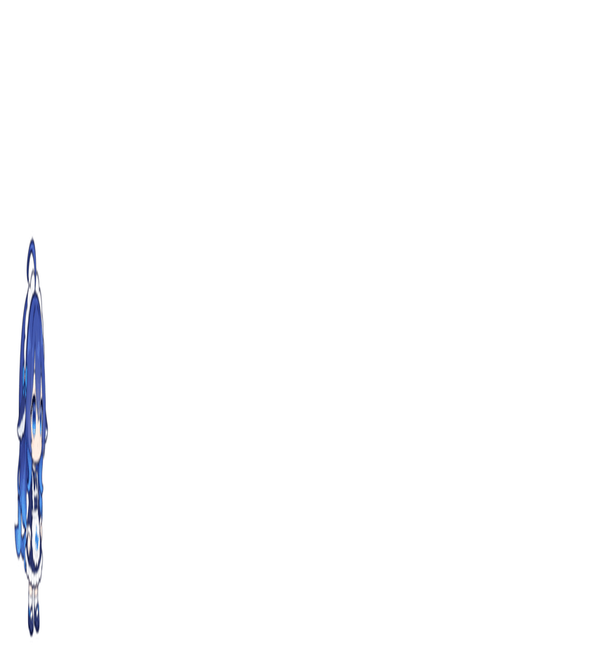

# 大肥鱼 · Hermes 桌宠

把 [Pal-AI-Lab/Coopanion](https://github.com/Pal-AI-Lab/Coopanion) 的 DeepSeek 鲸鱼娘（`DeepSeek Chan` 形象包）
烘成 [Hermes Agent](https://github.com/NousResearch/hermes) 原生宠物系统的精灵图。

*A Coopanion whale-girl figure, baked into a Hermes petdex spritesheet — one seamless loop per agent state.*



---

## 来源与授权（重要）

| | |
|---|---|
| **形象与动画** | [Pal-AI-Lab/Coopanion](https://github.com/Pal-AI-Lab/Coopanion) 的 `DeepSeek Chan` 形象包 —— **AGPL-3.0-or-later** |
| **角色本身** | DeepSeek 的社区二创，**不是原始 IP**。上游这么发，这里也照同样的口径 |
| **本仓库** | 烘焙产物 + 烘焙管线，同样是 **AGPL-3.0-or-later**（见 [LICENSE](LICENSE)） |
| **没有包含** | Coopanion 的源码和贴图。重烘时请自行 clone 上游 |

**这是非官方的粉丝衍生作品**，和 DeepSeek、Nous Research 都没有关系。

AGPL 的传染性意味着：你分发这个精灵图（或它的改版），整个衍生作品都要按 AGPL 开源并提供源码。
本仓库里的 `pipeline/` 就是那份"对应的源码"。

---

## 装到 Hermes

```bash
cp -r pets/dafeiyu <HERMES_HOME>/pets/
```

然后在 Hermes 里：

```
/pet 大肥鱼
```

或者 `/pet list` 挑，`/pet scale 0.5` 调大小。删掉 `<HERMES_HOME>/pets/.thumbs/dafeiyu.png`
可以让缩略图重新生成。

---

## 两边的东西根本不是一回事

理解这个仓库在干什么，先要知道源和目标是两种完全不同的东西：

| | Coopanion | Hermes |
|---|---|---|
| 形态 | 代码驱动的实时骨骼动画 | 静态精灵图 |
| 帧率 | requestAnimationFrame，60fps | **6 帧 / 状态，固定 1100ms 一轮 = 5.45fps** |
| 内容 | 37 个词条（19 表情 + 18 动作），8 配色 × 2 服装 | 9 行 × 8 列网格，每帧 192×208 |
| 驱动 | 鼠标、拖拽、麦克风、agent 事件 | 只有 agent 状态 |

所以"烘焙"不是录屏，是**把每个动作按它自己的周期采样成 6 帧**。

Hermes 的网格规格写在 `agent/pet/constants.py`：`FRAMES_PER_STATE = 6`、`LOOP_MS = 1100`，
行名固定为 `idle / running-right / running-left / waving / jumping / failed / waiting / running / review`。

---

## 我改了什么

上游动画是**对的**，错的是第一版烘焙管线。下面每一条都是实测出来的，不是猜的。

### 1. 状态串味 —— 五行里有三行根本不是那个动作

`act('wave')` 和 `setExpr()` 都**不重置 `pet.mode`**。第一版整轮共用一个页面，于是：

| 行 | 第一版实际烘到的东西 |
|---|---|
| `waving` | 在上一行 `running-left` 留下的**走路姿势**上招手 |
| `review` | 排在 `run` 之后，是**忍者跑姿势**顶个思考气泡 |
| `failed` / `waiting` | 还挂着跳跃没落地的余波，甚至残留上一行的泪滴粒子 |

→ **每个状态开一个干净页面**。顺带一个坑：`Page.navigate` 不等加载完成，
`Runtime.evaluate` 会读到**上一个页面**的 `__bake`，所以每次导航带一个唯一参数，等它回来。

### 2. 眼泪是黑疙瘩

粒子按 CSS class 上色（`.tearf{fill:var(--tear)}`），而那些 class 定义在演示页
`examples/whale/index.html` 里、**不在包里**。烘焙页没有它们，`var(--tear)` 取不到值就
fallback 成 `fill: black` —— 「难过」整行脸上一坨黑。

→ `harness.html` 里补上这几条 class。

### 3. 取帧节奏 —— 每个状态都错

第一版对所有状态都用 183ms 硬采 6 帧，但每个动作有自己的周期：

| 动作 | 真实周期 | 用 183ms 采样的后果 |
|---|---|---|
| 跑 `run` | 227 ms | **1.24 采样/周期**，步态完全混叠成抖动 |
| 走 `walk` | 476 ms | 2.6 采样/周期，看着像滑步 |
| 呼吸 | 2618 ms | 只覆盖 42%，接缝处跳 |
| 招手 `wave` | 1600 ms 脉冲 | 只采到前 920ms，手臂弹簧还滞后 ~0.5s，6 帧里只有 2 帧手是抬着的 |
| 跳 `jump` | ~1200 ms | 只采到 920ms，**落地帧根本没采到**，循环从半空直接跳回站立 |

→ **每个状态自己定一个源时间跨度**，正好等于它的一个周期（或一整个手势），
在这段里等距取 6 个相位，格子再用 1100ms 播完这段。快的动作变成慢动作，全部首尾相接。

### 4. 眨眼和眼神是随机的

`pet.blinkT` / `pet.glance` 都由 `Math.random()` 驱动，烘出来每轮都不一样，接缝处跳。

→ 烘焙时冻结这两个值。

### 5. 取景框被带偏

`getBoundingClientRect()` 给的是形象**画布视口**（280×280 的 `foreignObject`），不是墨迹范围；
思考气泡又会把并集撑宽。两件事一起把框撑大，鲸鱼只占格子高度的 **56%**，跳起来的拉伸还切掉头发。

→ 先用一个宽裕的固定窗口抓帧，量出**真实墨迹并集**，再按并集算一个**所有行共用**的框，
锚点钉在 `pet.x`，所以切状态时不会左右跳。站立姿势占比 **56% → 61%**。

### 6. 弹簧余振（这条最隐蔽）

新页面上所有弹簧从 0 开始往目标荡。形象身上的挂饰弹簧是 `spring(28, 1.8)` —— 阻尼比 0.17，
**十几秒后还在晃**。它让每轮循环的接缝处多出一次跳变。

→ setup **之前**先空跑 20s（`settle`）。另外 setup 本身还有一段短余振（表情的眉毛/眼睑/嘴要渐变过去），
setup **之后**再跑 2s（`warm`）才开始取帧。

实测：`idle` 行的接缝跳变从「正常步长的 2.5 倍」降到 1.5 倍。

### 效果

| | 第一版 | 现在 |
|---|---|---|
| `idle` 帧间运动量 | 6.44（随机噪声） | 0.95（干净呼吸） |
| `idle` 接缝跳变 | 6.69 | 1.03 |
| `waving` 手臂抬起 | 6 帧里 2 帧 | 6 帧里 3 帧，且起落都在循环内 |
| `jumping` | 落地帧丢失、顶点切头发 | 完整蹲→腾空→落地弧线 |
| `review` | 忍者跑姿势 | 站立思考 + 气泡 |

---

## 每个状态覆盖多少源时间

| Hermes 行 | Coopanion 词条 | 跨度 | 理由 |
|---|---|---|---|
| idle | 平静 `neutral` | 2.618 s | 一次呼吸（`sin(2.4t)`） |
| running-right | 走走 `walk` 右向 | 0.476 s | 一个步态周期（`phase += 2π·2.1·dt`） |
| running-left | 走走 `walk` 左向 | 0.476 s | kit 自动镜像 |
| waving | 招手 `wave` | 2.6 s | 脉冲 1.6s + 手臂弹簧落回 |
| jumping | 跳 `jump` | 0.95 s | 蹲 → 腾空 → 落地 |
| failed | 难过 `sad` | 2.618 s | 一次呼吸 |
| waiting | 犯困 `sleepy` | 4.2 s | 一个哈欠周期（`(t%4.2)/1.6`） |
| running | 跑 `run` | 0.227 s | 一个跑步周期（`phase += 2π·4.4·dt`） |
| review | 思考 `thinking` | 1.25 s | 一个思考气泡周期（`(t·0.8 + i/3) % 1`） |

---

## 重新烘焙

```powershell
$env:HNODE   = '<path>\node.exe'
$env:HCHROME = '<path>\chrome.exe'
$env:HOUT    = '<out dir>'
$env:HSCHEME = 'deepseek-maid'    # 或 deepseek-cape / claude-maid / qwen-cape …（8 配色 × 2 服装）
$env:HDEST   = '<HERMES_HOME>\pets\dafeiyu\spritesheet.png'   # 可选：直接覆盖装好的宠物
& $env:HNODE pipeline\bake2.mjs
```

可用配色：`deepseek` `harness` `chatgpt` `claude` `gemini` `qwen` `kimi` `minimax`。

**前置**：把 Coopanion 放到 serve2 的根目录下（`serve2.mjs` 的根是 `pipeline/` 的上一级），
默认路径是 `coopanion-src/packages/cortico-world-desktop-pet`。
布局不一样就设 `HPKGURL`：

```powershell
$env:HPKGURL = '/vendor/coopanion/packages/cortico-world-desktop-pet'
```

---

## 管线文件

| 文件 | 作用 |
|---|---|
| `serve2.mjs` | 静态服务器，根是 `pipeline/` 的上一级 —— 这样烘焙页能 import 到 Coopanion 包，**而不用往那个 checkout 里写任何文件** |
| `harness.html` | 烘焙页：加载形象包、暴露 `__bake`（setup / step / flush / freeze / noFx），补上粒子用的 CSS class |
| `compose.html` | 合成页：解码抓到的 PNG、量墨迹、拼网格。它**从不导航**，所以各状态抓的帧能留到收尾 |
| `bake2.mjs` | 主流程：逐状态开干净页面 → 定格 → 按各自跨度取 6 帧 → 按真实墨迹算共用取景框 → 拼图 |
| `cdp.mjs` | 极简 CDP 客户端（Node 自带 WebSocket，零依赖） |
| `check-harness.mjs` | 冒烟检查：harness 页能不能正常加载（改完 import 路径后跑一下） |

---

## 已知取舍

- **`failed` 的眼泪关掉了。** 泪滴每 0.8s 生成、寿命 3s，塞不进 1.1s 的循环，接缝处会跳。
  难过的表情（垂眉 + 大眼睛）自己撑得住。
- **`idle` / `failed` / `review` 的接缝还有约 1px 微抖。** 形象身上同时跑着好几个独立振荡器
  （呼吸 2.4、头部摇摆 0.9、尾巴 5.25 和 1.3、气泡 0.8 rad/s），**没有任何一个跨度能同时是它们所有周期的整数倍**
  （最小公倍数 ≈ 48 个呼吸周期 ≈ 126s）。现在按每行的**主要**动作选跨度，剩下的残差在 1px 量级，肉眼看不出来。
- **Hermes 用不到第 7、8 列。** 网格是 8 列但 `FRAMES_PER_STATE = 6`，多出来的两列是第 6 帧的复制，凑满 petdex 规格。

---

## 许可

**AGPL-3.0-or-later**，见 [LICENSE](LICENSE)。

Coopanion 是 AGPL-3.0-or-later；鲸鱼娘形象本身是 DeepSeek 的社区二创。
自己用没问题；**分发**（或挂成网络服务）时整个衍生作品都要按 AGPL 开源并提供源码。
